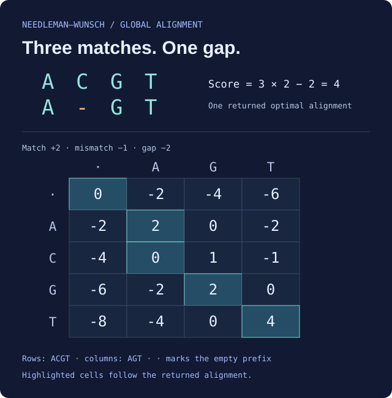

# SequenceForge algorithm reference

This reference describes the retained implementation. Ready-to-use instances use the constructor defaults below; import classes when you need different parameters. `sequenceforge` is the primary namespace, and the `goombay` compatibility import remains available.

## Methods and returned objects

`distance`, `similarity`, `normalized_distance` and `normalized_similarity` are algorithm-specific numeric scores. They are not uniformly integers, mathematical distances or values bounded by zero and one. See [current limitations](#caveats).

`align` also varies: pairwise edit aligners generally return a formatted string, with a list of strings when supported `all_alignments=True` is requested. Common-subsequence, common-substring and Ratcliff–Obershelp methods return motif lists; supersequence, prefix and postfix methods return a string. Feng–Doolittle returns joined aligned rows. Do not assume every aligner accepts the same keywords or uses the same no-match sentinel.

## Implementation

Classes and instances below are exported by `sequenceforge`. All listed pairwise methods expose the four score methods, subject to their input and normalization limitations.

| Class | Default instance | `.matrix` result |
| --- | --- | --- |
| `NeedlemanWunsch` | `needleman_wunsch` | `(scores, pointers)` |
| `Gotoh` | `gotoh` | `(D, P, Q)` score arrays |
| `GotohLocal` | `gotoh_local` | `(D, P, Q)` score arrays |
| `SmithWaterman` | `smith_waterman` | `(scores, pointers)` |
| `WatermanSmithBeyer` | `waterman_smith_beyer` | `(scores, pointers)` |
| `WatermanSmithBeyerLocal` | `wsb_local` | `(scores, pointers)` |
| `WagnerFischer` | `wagner_fischer` | `(scores, pointers)` |
| `LowranceWagner` | `lowrance_wagner` | `(scores, pointers)` |
| `Hirschberg` | `hirschberg` | Small full matrix if either input length is at most one; otherwise a `(1, 0)` placeholder |
| `Hamming` | `hamming` | `None` |
| `Jaro` | `jaro` | One array |
| `JaroWinkler` | `jaro_winkler` | One array |
| `LongestCommonSubsequence` | `longest_common_subsequence` | One array |
| `LongestCommonSubstring` | `longest_common_substring` | One array |
| `ShortestCommonSupersequence` | `shortest_common_supersequence` | One array |
| `LIPNS` | `lipns` | One array |
| `MLIPNS` | `mlipns` | One array |
| `Hamann` | `hamann` | One array |
| `SimpleMatchingCoefficient` | `simple_matching_coefficient` | One-row match/mismatch count matrix; scalar comparisons require nonempty, equal-length inputs |
| `LengthRatio` | `length_ratio` | One array |
| `Prefix` | `prefix` | One array |
| `Postfix` | `postfix` | One array |
| `RatcliffObershelp` | `ratcliff_obershelp` | No method |

`FengDoolittle` / `feng_doolittle` provides multiple alignment; calling the instance returns `(profiles, distance_matrix)`. `LongestCommonSubstringMSA` / `longest_common_substring_msa` provides common-substring multiple alignment and score methods, with no `.matrix` method. Tree helpers `NeighborJoining` and `NewickFormatter` live in `sequenceforge.phylo`; both accept `dist_matrix`. `NeighborJoining.generate_newick()` produces Newick output; `NewickFormatter.parse_newick(newick)` parses a Newick string.

Calling Gotoh or GotohLocal directly additionally returns a fourth tuple containing three pointer arrays. For Needleman–Wunsch, calling directly and using `.matrix` both return the score/pointer pair.

## Constructor keywords and defaults

These are actual accepted keyword names. Older examples using `match_score`, `mismatch_penalty`, `gap_penalty` or `scoring_matrix` do not match the current constructors.

| Class | Defaults |
| --- | --- |
| `NeedlemanWunsch` | `match=2, mismatch=1, gap=2, substitution_matrix=None` |
| `Gotoh` | `match=1, mismatch=1, new_gap=3, continued_gap=1, substitution_matrix=None` |
| `GotohLocal` | `match=2, mismatch=1, new_gap=3, continued_gap=2, substitution_matrix=None` |
| `SmithWaterman` | `match=1, mismatch=1, gap=2` |
| `WatermanSmithBeyer`, `WatermanSmithBeyerLocal` | `match=1, mismatch=1, new_gap=3, continued_gap=1, substitution_matrix=None, gap_function="affine"` |
| `Hirschberg` | `match=1, mismatch=2, gap=4, substitution_matrix=None` |
| `FengDoolittle` | `cluster="nj", pairwise="nw", substitution_matrix=None` |
| `JaroWinkler` | `scaling_factor=0.1` |
| `LIPNS` | `threshold=0.25` |
| `MLIPNS` | `max_mismatch=2` |

The other comparison classes take no constructor arguments. Waterman–Smith–Beyer also accepts `gap_function="quadratic"`, `"log"` or `"logarithmic"`; invalid names raise `ValueError` when scoring invokes the function. Use lowercase names or aliases for Feng–Doolittle's algorithm selection.

Substitution matrices use nested residue lookup, `matrix[a][b]`; callers must supply an appropriate alphabet. NeedlemanWunsch, Gotoh, GotohLocal, both WatermanSmithBeyer classes and Hirschberg accept `substitution_matrix`. FengDoolittle forwards one to supported pairwise implementations. Biobase matrices are supported by existing examples and tests. Choose gap costs appropriate to that matrix; a shared numeric scale or valid normalization is not guaranteed across all custom settings. See `tests/test_edit/test_SubMatrix.py`.

## Inspect an alignment

```python
from sequenceforge import needleman_wunsch as nw

print(nw.align("ACGT", "AGT"))
# ACGT
# A-GT
assert nw.similarity("ACGT", "AGT") == 4
scores, pointers = nw.matrix("ACGT", "AGT")
assert scores.shape == pointers.shape == (5, 4)
print(scores)
# [[ 0. -2. -4. -6.]
#  [-2.  2.  0. -2.]
#  [-4.  0.  1. -1.]
#  [-6. -2.  2.  0.]
#  [-8. -4.  0.  4.]]
```



The [example data](alignment-example.json) records exact scores, pointers, parameters and source hashes. Its generation used the unchanged base/edit modules directly with NumPy; it does not establish installed-package or Biopython integration.

For equal-length nonempty strings, Hamming provides positional comparisons:

```python
from sequenceforge import hamming

assert hamming.distance("AFTG", "ACTG") == 1
assert hamming.similarity("AFTG", "ACTG") == 3
assert hamming.binary_distance_array("AFTG", "ACTG") == [0, 1, 0, 0]
assert hamming.normalized_distance("AFTG", "ACTG") == 0.25
assert hamming.binary_similarity_array("AFTG", "ACTG") == [1, 0, 1, 1]
assert hamming.normalized_similarity("AFTG", "ACTG") == 0.75
```

## Algorithm distinctions

Global aligners score the full sequences; local aligners search for high-scoring regions. Wagner–Fischer computes unit-cost insertion/deletion/substitution distance. The retained Lowrance–Wagner implementation uses a restricted adjacent-swap recurrence: it must not be assumed to compute unrestricted Damerau–Levenshtein distance (`CA` → `ABC` returns 3, while an unrestricted two-edit path exists).

Subsequence alignment preserves character order while allowing gaps; substring alignment requires contiguous characters. Their alignment helpers suppress length-one motifs by default, and their scalar edge conventions differ. ShortestCommonSupersequence returns a containing supersequence, but its `.distance` is insertion/deletion edit cost, not supersequence length minus the longer input length.

Jaro-family scores account for nearby matches and transpositions; Jaro–Winkler adds a prefix adjustment. Hamann similarity can be negative. LengthRatio compares lengths. Prefix and Postfix compare contiguous end matches. LIPNS and MLIPNS expose fractional score methods plus `.is_similar` for a binary decision.

### Read the dynamic-programming choices

For Needleman–Wunsch, cell `S[i,j]` scores the two prefixes ending at query position `i` and subject position `j`. Each cell takes the best of a diagonal character comparison, a vertical gap and a horizontal gap:

```text
S[i,j] = max(S[i-1,j-1] + character_score,
             S[i-1,j] - gap,
             S[i,j-1] - gap)
```

The first row and column account for leading gaps. Traceback starts at the bottom-right cell for a global alignment. In the illustrated example, the path from `(0,0)` to `(4,3)` includes one vertical step, pairing the query's `C` with a gap. Local Smith–Waterman instead permits a zero restart so a poorly scoring prefix need not become part of the selected region. See the [Needleman–Wunsch paper](https://bytes.usc.edu/cs270/docs/needleman-wunsch-1970.pdf) for the original global-alignment work; the example above verifies only the declared implementation and input.

### Charge a gap run differently from separate gaps

A linear gap cost charges `k * gap` for a run of `k` missing characters. Gotoh separates an overall score state `D`, vertical gap state `P` and horizontal gap state `Q`, allowing extension of an existing gap to differ from opening another. The retained implementation uses the convention `new_gap + k * continued_gap`, so a one-character run includes both terms. Waterman–Smith–Beyer considers possible gap lengths explicitly; its `_gap_func(k)` uses that same affine expression by default, or the selected quadratic/logarithmic expression. These are source conventions, not interchangeable parameter names from another library. The constructor table and returned-array table above describe the actual interface. [Gotoh's original paper](https://pubmed.ncbi.nlm.nih.gov/7166760/) explains the affine-gap approach.

Substitution matrices replace the character comparison term, not the surrounding API. A minimal explicit alphabet makes the nested lookup visible:

```python
from sequenceforge import NeedlemanWunsch

matrix = {"A": {"A": 3, "C": -2}, "C": {"A": -2, "C": 3}}
custom = NeedlemanWunsch(substitution_matrix=matrix, gap=3)
assert custom.similarity("AC", "AC") == 6
```

This toy matrix covers only `A` and `C`. Supply the complete alphabet for real inputs, and calibrate gap costs to that matrix. This example does not validate custom-score normalization or reproduce the protein examples' historical outputs.

### Trade a full matrix for recursive alignment

Hirschberg uses forward/backward score profiles and recursively splits the alignment problem. Its `_score` routine retains two score rows rather than a complete table. This is the divide-and-conquer idea described in [Hirschberg's paper](https://ics.uci.edu/~dhirschb/pubs/p341-hirschberg.pdf); it is not a benchmark or a claim that every allocation in this Python implementation has been measured. Here `.matrix` returns a full score array only for the small base case and a placeholder otherwise. Choose an aligner exposing a full matrix when inspecting every cell is the task.

### Separate motifs, progressive alignment and trees

For `ACGT` and `AGT`, a common subsequence can be `AGT`, while a common substring must stay contiguous (the shared `GT`). A supersequence contains each input in order. These solve different tasks from a scored two-row alignment, and their helpers return different objects.

Feng–Doolittle first uses a selected pairwise method to build a distance matrix, then uses a guide tree to combine sequence profiles progressively. Changing that pairwise method or its scoring settings changes the guide information. The current `merge_profiles` aligns the first sequence of each profile as its representative and applies those gap patterns to all members; it does not optimize a full profile-to-profile score. Progressive alignment does not independently certify an optimal multiple alignment or evolutionary distance. The retained notebooks are historical examples, and their outputs were not regenerated by this documentation change.

### Further reading and retained provenance

The original guide's [Lowrance–Wagner research article](https://bmcbioinformatics.biomedcentral.com/articles/10.1186/s12859-019-2819-0), [Feng–Doolittle teaching notes](https://www.cs.auckland.ac.nz/compsci369s1c/lectures/DW-notes/lecture21.pdf), [LIPNS/MLIPNS paper](http://www.sial.iias.spb.su/files/386-386-1-PB.pdf) and [Hamann reference](https://modbase.compbio.ucsf.edu/pibase/suppinfo/supplementary_info.pdf) remain useful starting points. Algorithm names do not establish that this implementation has all properties of the cited method; in particular, the retained adjacent-swap implementation has the restriction noted above. [references.txt](../references.txt) separately retains the original code/scoring sources and author credits.

## Caveats

The implementation is preserved; the following are observed limits, not promises that every other input is correct:

- The GlobalBase distance used by NeedlemanWunsch, Gotoh and WatermanSmithBeyer converts the raw score using an absolute value. With defaults, `gotoh.distance("A", "B")` is zero despite a raw score of −1. `NeedlemanWunsch(match=1, mismatch=4, gap=5).distance("A", "B")` is −3. Use raw scores carefully; do not assume metric properties.
- WatermanSmithBeyer initializes leading-gap boundaries with the affine formula even when `gap_function="quadratic"` or `"log"` is selected. For example, `WatermanSmithBeyer(gap_function="quadratic").matrix("AA", "")[0][-1, 0]` is −5 while `_gap_func(2)` is −7. Do not assume consistent nonlinear gap scoring at sequence edges.
- LocalBase normalization does not include the match reward. For example, `SmithWaterman(match=2).normalized_similarity("AA", "AA")` is 2. GotohLocal has a separate normalization implementation.
- Hamming accepts equal-length strings or two integers for raw comparison. Strings are case-insensitive; mixed types raise `TypeError` and unequal string lengths raise `IndexError`. Integer raw similarity counts shared one bits. Integer normalization currently raises `TypeError`; empty-string normalization divides by zero.
- `simple_matching_coefficient.matrix("A", "B")` returns `[[0.0, 1.0]]`: one row of match and mismatch counts. The repaired matrix layout is consistently `(1, 2)`; formerly successful all-match and empty calls returned `(1, 1)`, so callers that assume one column must adapt. SMC and Hamann scalar comparisons require nonempty inputs and delegate equal-length validation to Hamming.
- Common-substring MSA normalization divides by zero for a list containing only empty strings. An empty list instead raises `ValueError` from `max`. Prefix and Postfix normalized methods explicitly reject empty strings with `ValueError`. Empty-input conventions are method-specific.
- Feng–Doolittle strips and uppercases input, filters blank members, rejects all-blank/empty lists and returns a singleton string unchanged. Progressive alignment and tree helpers have not been independently validated for all profile, alphabet and matrix shapes.
- Both FASTA parsing helpers currently produce inconsistent identifier prefixes for a single record versus multiple records. Normalize identifiers explicitly when combining those results.

[Verification](VERIFICATION.md) records compatibility/parity evidence. Matched legacy errors are compatibility evidence, not independent proof of mathematical correctness. The [retained references](../references.txt) and [third-party notices](../THIRD_PARTY_NOTICES.md) preserve upstream credit and provenance.
